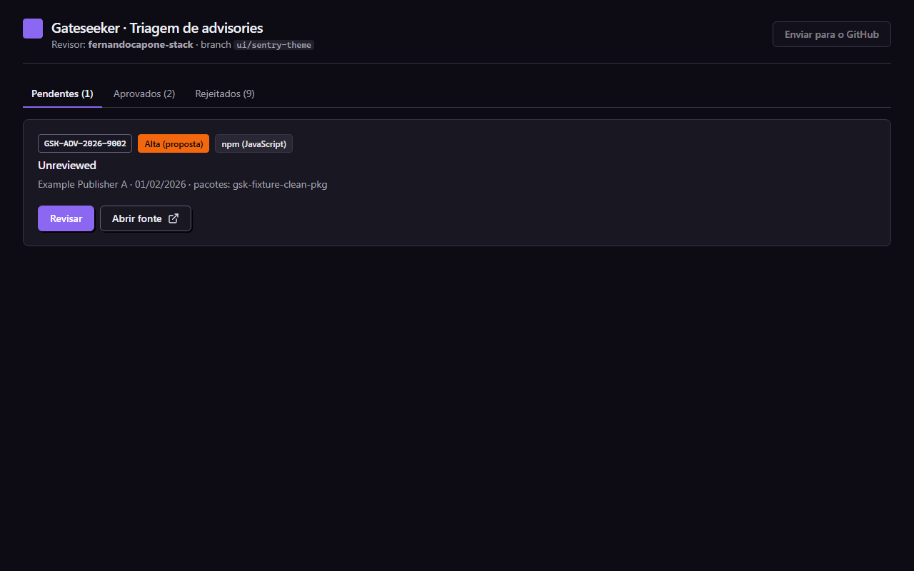
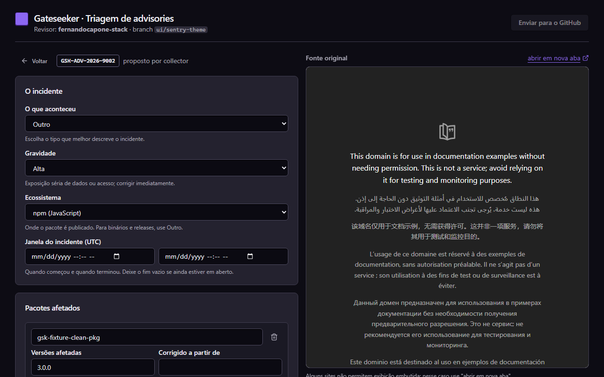
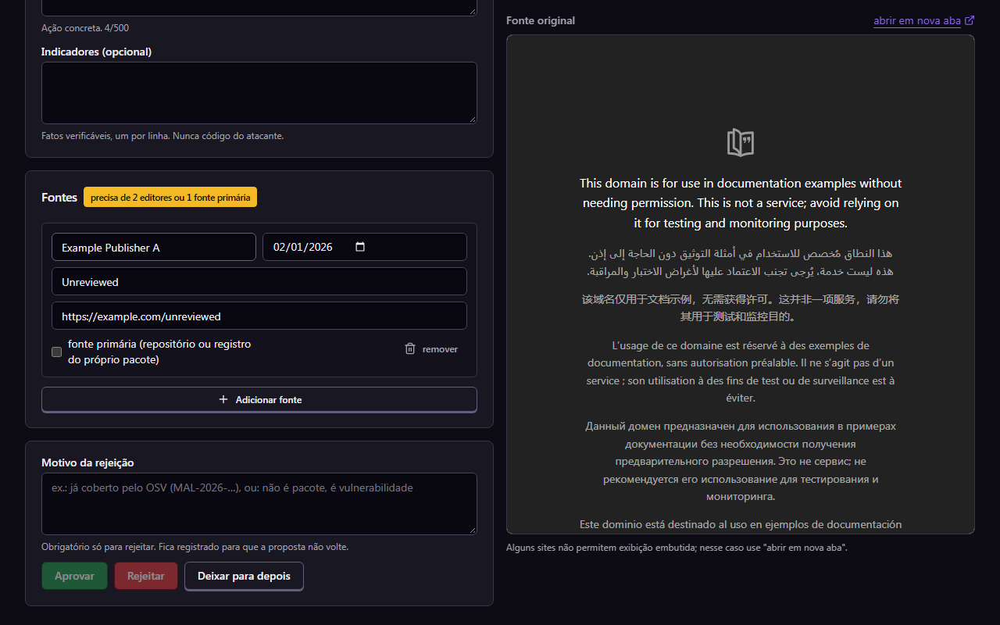

# Gateseeker

Security gate for AI-generated code. *(working description; branding and tagline are pending)*

Gateseeker points at a project directory, checks the code for the security mistakes most common in AI-generated apps, asks [OSV](https://osv.dev) which installed npm versions have known vulnerabilities, ranks every finding with deterministic and auditable rules, and returns a gate verdict with an exit code you can wire into CI.

**Status after Sprint 5:** npm (`package-lock.json` v2/v3, `pnpm-lock.yaml` v9, `yarn.lock` from Yarn 1 and Berry) and Composer (`composer.lock`) dependencies checked against OSV **and** a curated, human-approved advisory feed, with tag-rewrite verification against Packagist; structural supply-chain rules that compare a lockfile with a baseline; eight code-pattern rules for JavaScript/TypeScript projects. Runs as a CLI, as a GitHub Action, and in the browser. See [docs/PRODUCT.md](docs/PRODUCT.md) for direction and `docs/SPRINT_*.md` for the scope this code implements.

## Try it in the browser

Sign in with GitHub at [gateseeker.vercel.app](https://gateseeker.vercel.app), paste the URL of a **public** GitHub repository and get the same report the CLI produces, usually in under a minute. Nothing to install.

- Same engine, rules and wording as the CLI; pattern and supply-chain rules run in warn mode, and there is no baseline on the web.
- The repository is downloaded as an archive and read as text: nothing is cloned, installed or executed. Symbolic links are never created or followed; the report lists them as not read. Archives over 50 MB compressed are refused (use the CLI for those).
- Reports are saved for 30 days and open only for the account that produced them. Secrets are redacted before anything is saved.
- 10 analyses per account per hour; the same commit within 24 hours reuses the saved report without counting.

The workspace links each report to the GitHub Action below, with the repository already filled in.

## Use in GitHub Actions

```yaml
- uses: gateseeker-dev/gateseeker@v1
```

That single step, after your checkout, runs the scanner on every pull request: known vulnerabilities for npm and Composer, curated supply-chain advisories, structural lockfile signals (compared with the base branch automatically), and code-pattern rules. It writes a job summary, keeps one sticky comment on the pull request up to date (needs `pull-requests: write`), uploads SARIF to code scanning (needs `security-events: write`), and fails the job when the gate fails. An incomplete analysis fails too, by design; set `allow-incomplete: true` to accept that risk.

```yaml
permissions:
  contents: read
  pull-requests: write
  security-events: write

steps:
  - uses: actions/checkout@v7
  - uses: gateseeker-dev/gateseeker@v1
    with:
      fail-on: P2          # P1 | P2 | P3 | P4
      patterns: warn       # warn | gate
      supply-chain: warn   # warn | gate
```

| Input | Default | Meaning |
|---|---|---|
| `path` | `.` | Project directory. |
| `fail-on` | `P2` | Lowest priority that fails the gate. |
| `patterns`, `supply-chain` | `warn` | `gate` makes those rules count towards the verdict. |
| `only` | | `deps` or `patterns`. |
| `baseline-ref` | base branch on PRs | Ref holding the previous lockfile; empty disables the comparison. |
| `allow-incomplete` | `false` | Do not fail the job on an incomplete analysis. |
| `comment` | `true` | Sticky summary comment on the pull request. |
| `sarif` | `true` | Upload findings to code scanning. |
| `advisories` | | Local curated advisory set. |
| `output-dir` | `.gateseeker` | Where `report.json`, `gateseeker.sarif` and the baseline copy go. |
| `version` | pinned | npm version of the scanner the action runs. |

Outputs: `verdict`, `findings`, `p1`..`p4`, `report`, `sarif`.

The Action is the only part of Gateseeker that runs git (to read the base branch's lockfile inside your own workflow); the scanner never does.

## Requirements

- Node.js 24 or later
- pnpm 12 (the repository pins `packageManager`; `corepack enable` or `npm install -g pnpm`)

## Install and run from source

```bash
pnpm install
```

```bash
pnpm build
```

```bash
node dist/cli.js scan ./path/to/project
```

During development you can skip the build:

```bash
pnpm dev scan fixtures/projects/vibe-next-supabase
```

## Usage

```
gateseeker scan <project-dir | package-lock.json | composer.lock> [options]

  A directory runs the code-pattern rules and, for every package-lock.json or
  composer.lock at its root, the dependency analysis. A lockfile path runs
  dependencies only.

  --format <text|json|sarif|summary>
                            Output format (default: text). sarif: SARIF 2.1.0 for
                            code scanning; summary: Markdown for job summaries.
  --output <file>           Also write the JSON report to <file>
  --fail-on <P1|P2|P3|P4>   Priority threshold for a failing gate (default: P2)
  --only <deps|patterns>    Run a single analysis (directory scans only)
  --patterns <warn|gate>    warn: pattern findings are reported but do not
                            affect the verdict (default). gate: they do.
  --supply-chain <warn|gate>
                            Same switch for the structural supply-chain rules
                            (GSK-SC-*). Curated advisory matches are always gated.
  --baseline <lockfile>     A previous lockfile of the same kind to compare with
  --max-release-age-days <n>
                            Flag releases newer than n days (default: 3; 0 disables)
  --no-packagist            Skip Packagist lookups; tag-rewrite matches become unverified
  --max-size <bytes>        Reject lockfiles larger than this (default: 5242880)
  --max-deps <n>            Reject lockfiles with more packages than this (default: 5000)
  --max-files <n>           Abort directory scans with more files (default: 5000)
  --max-file-size <bytes>   Abort directory scans on a larger text file (default: 1048576)
  --advisories <file>       Use this curated advisory set (JSON) instead of the bundled one
  --timeout <ms>            Per-request timeout for the OSV API (default: 10000)
  --concurrency <n>         Maximum simultaneous OSV requests (default: 5)
```

### Exit codes

| Code | Verdict | Meaning |
|---|---|---|
| `0` | `pass` | Every dependency was queried and no gated finding reached the `--fail-on` threshold. |
| `1` | `fail` | At least one gated finding at or above the threshold. |
| `2` | `incomplete` | At least one dependency query failed or a dependency could not be queried. **Never** reported as `0`, regardless of findings. |
| `3` | usage | Bad arguments, unreadable path, lockfile rejected (malformed, unsupported version, over limits), or directory over the walker limits. |

`fail` takes precedence over `incomplete`. In the default `--patterns warn` mode, code-pattern findings appear in the report with their priority but do not change the verdict; use `--patterns gate` once you have reviewed them.

A directory without `package-lock.json` has its dependencies declared `not-analyzed` in the report; that is not `incomplete`, because no query failed.

### Example output

Produced against `fixtures/projects/vibe-next-supabase` with `--only patterns` (counts may differ slightly as fixtures evolve):

```
gateseeker 0.1.0  run 1a05db4a-baa8-4391-a94e-9409000159af
project        .../fixtures/projects/vibe-next-supabase
dependencies   not analyzed (no package-lock.json at root, or --only patterns)
code           20 files scanned, 1 ignored, 1 binary; 8 rules; mode warn
sources        gateseeker-rules

Findings: 18  (P1 13, P2 3, P3 2, P4 0)  dependencies 0, code patterns 18
  [P1] .env:2  GSK-SECRET-001  Credential with a known provider format is hardcoded
       Hardcoded credential of type "supabase-service-role-jwt" (219 characters).
       code:     SUPABASE_SERVICE_ROLE_KEY=eyJh…[219 chars]
       severity: CRITICAL (env file)   why: rule:GSK-SECRET-001, base:critical/direct-prod=P1, fix-available
       action:   Revoke the credential at the provider, move it to a server-side environment variable or secret manager, and purge it from git history.
       impact:   Anyone who can read this code (the repository, the published bundle or a leaked copy) can use this Supabase service_role key as you.
       steps:    1. Revoke or rotate the Supabase service_role key at the provider now: assume it is already exposed.
                 2. Replace the literal with an environment variable read only in server code.
                 3. If the repository is or was public, remove the value from the git history too.
  ...

GATE: PASS (fail-on P2, patterns warn)
  Code patterns were analyzed in warn mode (not gated); no finding at priority P2 or higher. ...
```

Secrets are never printed: a matched credential is shown as its first four characters and its length.

Each finding also carries plain-language fix guidance: `impact` (what could happen) and `manualSteps`, shown above, plus `aiPrompt` in the JSON report and on the web, a text to paste into Cursor, Lovable or Claude Code. The guidance is written per rule by the maintainers and is deterministic; no model generates it, and it is built only from the finding's location and names, never from the matched code.

`pnpm-lock.yaml` (lockfileVersion 9, pnpm 9 and later) and `yarn.lock` (Yarn 1 and Berry) are read without running pnpm or Yarn. When a project has more than one npm lockfile, Gateseeker reads one, in the order `package-lock.json`, `pnpm-lock.yaml`, `yarn.lock`, and lists the others as not read. Yarn lockfiles do not mark dev dependencies, so the root `package.json` decides what is direct and what is dev; without it every package counts as production. A project whose only lockfile is Bun's (`bun.lock`, `bun.lockb`) gets the verdict `incomplete` (exit code 2), because that format is not read yet and the absence of dependency findings cannot be asserted.

## Supply-chain signals (Composer and npm)

Besides known vulnerabilities, `gateseeker scan` looks for the shape of a supply-chain compromise:

- **Curated advisories with tag rewrites.** For a Composer package named in an approved record with `affected.tags` and `commits_after`, the scanner compares the commit pinned in `composer.lock` with the commit Packagist serves today for the same version. A different commit, or a commit dated inside the incident window, is a `supply-chain-anomaly` finding. Without network (`--no-packagist`, or Packagist down) the time check alone decides and the finding is marked **unverified**; the run is `incomplete`, never `pass`.
- **Structural rules**, no network, warn mode by default (`--supply-chain gate` to block):

| Id | Signal | Needs baseline | Severity |
|---|---|---|---|
| `GSK-SC-001` | Production dependency pinned to a branch/commit or a git/tarball URL instead of a published version | no | MODERATE |
| `GSK-SC-002` | An existing dependency gained `autoload.files` or install scripts | yes | HIGH |
| `GSK-SC-003` | Same version now resolves to a different commit (Composer) or integrity hash (npm): the signature of a rewritten tag or replaced artifact | yes | CRITICAL |
| `GSK-SC-004` | A dependency was released in the last 3 days (configurable) | no | LOW |
| `GSK-SC-005` | A dependency's source moved to another host | yes | HIGH |

The baseline is a previous lockfile of the same kind. In CI, before calling Gateseeker:

```bash
git show origin/main:composer.lock > /tmp/base.lock
```

```bash
node dist/cli.js scan . --baseline /tmp/base.lock
```

Gateseeker never runs git itself. The report prints the hashes of both lockfiles.

A dependency pinned to a branch (`dev-main`) cannot be looked up in any registry, so it is reported as not queried and the run ends `incomplete` until it is pinned to a release; the same rule that keeps a failed query from counting as clean applies here.

## Curated advisory feed

Official vulnerability databases miss a class of incident: a package whose existing tags or versions are rewritten with malicious code, with no new version number and no CVE. Five months after the Laravel-Lang Composer compromise of May 2026, OSV still had no record of it. Gateseeker keeps its own curated set of such incidents under [advisories/](advisories/README.md):

- A scheduled workflow (`Intel feed`, every 6 hours) reads public security feeds, keeps entries that look like supply-chain incidents, and opens a pull request with proposed records. It stores only titles, links and dates, never the text of a source.
- A named reviewer completes each record and marks it `approved` or `rejected`. Nothing is merged or consumed automatically.
- `pnpm build` compiles `advisories/approved/` into `dist/advisories.json`; `gateseeker scan` matches npm and Composer dependencies against it (versions, ranges, and tag rewrites verified against Packagist) and reports hits as `supply-chain-anomaly` findings with the record's severity, sources and reviewer.
- The collector asks OSV about every package candidate it extracts and pre-fills a draft with the official ids when the incident is already covered, so the reviewer can reject duplicates in one click.
- Approved records are offered upstream to OSV/GHSA following [docs/UPSTREAM.md](docs/UPSTREAM.md). Advisory data is CC-BY-4.0.

Maintainer commands: `gateseeker-intel collect | validate | build | ui`.

### Reviewing proposals without touching JSON

```bash
pnpm build
```

```bash
node dist/intel-cli.js ui
```

opens a local triage interface in the browser (127.0.0.1 only, with a per-session token in the address). It merges the newest open `intel/*` branch into the current one, lists pending proposals in plain language, shows the original source beside the form, and offers **Aprovar**, **Rejeitar com motivo** and **Deixar para depois**. Each decision validates the record against the schema, records the git user as reviewer, moves the file to `advisories/approved/` or `advisories/rejected/`, and makes one local commit; **Enviar para o GitHub** pushes when the batch is done. Approving requires two sources from distinct publishers or one primary source, exactly like the CI check. Engineering can pre-fill a `draft` block that the reviewer confirms field by field; drafts are never read by the scanner and are removed on decision.

The interface lives in `ui/` (Vite, React, Tailwind, shadcn-style components) and is served by the `gateseeker-intel ui` command from `src/intel/ui/`. It only runs `git add`, `commit`, `push`, `fetch` and `merge --no-edit`; everything else is refused.







The theme is dark by default, with a light variant selected by the operating system's `prefers-color-scheme`. Colours, radius and the solid-offset shadows are design tokens in `ui/src/index.css` (`:root` and `@theme inline`); the screenshots use the synthetic fixture from `fixtures/intel/advisories/`.

## Code-pattern rules

Rules are lexical and structural checks on text files. They never execute project code and never follow data flow. Each one ships with positive and negative fixtures in `fixtures/projects/`.

| Id | Detects | Severity |
|---|---|---|
| `GSK-SECRET-001` | Credential with a known provider format hardcoded: AWS access key, Stripe live key, GitHub token, OpenAI and Anthropic keys, Slack token, PEM private key, Supabase `service_role` JWT. Skips tests, `.env.example`, docs, placeholders and low-entropy tokens. | CRITICAL |
| `GSK-SECRET-002` | Variable with a client-bundle prefix (`NEXT_PUBLIC_`, `VITE_`, `REACT_APP_`, `EXPO_PUBLIC_`, `NUXT_PUBLIC_`, `PUBLIC_`) named like a secret. Known public names (`ANON_KEY`, `PUBLISHABLE`, `CLIENT_ID`, Mapbox `pk.` tokens, ...) are allowed. | CRITICAL |
| `GSK-SUPABASE-001` | Table created in `supabase/` migrations without any `enable row level security`, or disabled in a later migration. Unexposed schemas (`auth`, `storage`, ...) are skipped. | HIGH |
| `GSK-SUPABASE-002` | Client-side file references a `SERVICE_ROLE` environment variable. | CRITICAL |
| `GSK-FIREBASE-001` | Firestore/Storage rule with `if true`, or Realtime Database `".read"`/`".write": true`. | HIGH (MODERATE if read-only) |
| `GSK-CORS-001` | `Access-Control-Allow-Origin: *` in headers or config, `cors({ origin: "*" })`, or default `cors()`. | LOW (HIGH when the same file enables credentials; without credentials a wildcard is informational, and the Supabase Edge Function template ships it by default) |
| `GSK-ENV-001` | Root `.env*` file with non-public variables not covered by `.gitignore`. | MODERATE |
| `GSK-BUILD-001` | `next.config` with `ignoreBuildErrors` or `ignoreDuringBuilds` set to true. | LOW |
| `GSK-AGENT-001` | Committed AI-agent configuration that allows every shell command: Claude Code `Bash`, `Bash(*)`, `*` or `bypassPermissions`; Codex `approval_policy = "never"` with `danger-full-access`. | MODERATE |
| `GSK-AGENT-002` | Agent hook (in settings, a script under an agent directory, or the install/start steps of `.cursor/environment.json`) that pipes a download into a shell or runs an unpinned package (`@latest`, `npx -y`). | HIGH |
| `GSK-AGENT-003` | MCP server launched from an unpinned package, reached over plain `http://`, or with a literal secret in `env`/`headers` (value redacted). | MODERATE (HIGH for an inline secret) |
| `GSK-AGENT-004` | Hidden text in files agents follow (`CLAUDE.md`, `AGENTS.md`, `.cursorrules`, agent commands and rules): invisible Unicode characters, an HTML comment with instructions, a long encoded run. | HIGH for invisible characters, MODERATE otherwise |
| `GSK-AGENT-005` | `--no-verify`, `git commit -n` or `HUSKY=0` in agent instructions, `package.json` scripts or CI workflows. Lines that forbid it are skipped. | MODERATE |

The `GSK-AGENT-*` rules (Track A1) were measured on 10 public repositories in `docs/VALIDATION_SPRINT_5.md` (3 of 3 final findings correct, after fixing two false positives and one false negative found there); the sample is small, so like every rule they run in warn mode. `.mcp.json` and `.claude/settings.json` are strict JSON with no comments, so findings in them cannot be suppressed inline; VS Code's `mcp.json` accepts comments and can.

Code snippets in findings never carry hardcoded values: matched credentials are shown as their first four characters and length, dotenv values are hidden, and quoted string literals of eight or more characters next to a flagged variable are masked.

Google `AIza...` keys are intentionally not detected: Firebase web API keys use that format and are public by design, so the pattern alone cannot separate a secret from a public key.

### Suppressing a finding

Put a comment on the same line or the line above, with a mandatory reason:

```ts
res.headers.set("Access-Control-Allow-Origin", "*"); // gateseeker-ignore GSK-CORS-001 public webhook, no cookies
```

Suppressions are listed in the report with file, line, rule and reason. A suppression without a reason is ignored and reported as a warning.

### File classification

Rules apply to classes of files: `client`, `server`, `config`, `sql`, `env`, `rules`, `test`, `other`. Classification is by path convention (`app/**/route.ts` and `pages/api/**` are server; `"use client"` files, `components/`, `.tsx` and everything under `src/` in Vite projects are client; `__tests__/`, `*.test.*` are test) and is recorded on every finding. Test files lower the exposure to dev-only, which lowers priority.

## How priority is decided

Priority is a function of three facts, looked up in a single table in [src/rules/priority.ts](src/rules/priority.ts):

1. **Severity tier.** For dependencies: computed from the CVSS 3.x vector published by the source, else the source's qualitative rating, else `UNKNOWN` (treated like `MODERATE`). For code patterns: the rule's intrinsic severity, sometimes adjusted by the match (for example CORS with credentials).
2. **Exposure**: direct production dependency, transitive production dependency, or dev-only. Project code counts as direct production; test files as dev-only.
3. **Fix available**: whether the source lists a fixed version. Code-pattern findings always have an action.

| Severity | direct-prod | transitive-prod | dev-only |
|---|---|---|---|
| CRITICAL | P1 | P1 | P2 |
| HIGH | P1 | P2 | P3 |
| MODERATE | P2 | P3 | P4 |
| LOW | P3 | P4 | P4 |
| UNKNOWN | P2 | P3 | P4 |

Modifier: when no fixed version exists, demote one level, but never below P2 for CRITICAL or HIGH. Every applied rule is listed in the finding's `rationale` field.

## What "pass" does and does not mean

A `pass` means: every installed version was queried against OSV and the curated advisory set listed in the report's `sources`, the rules that ran found nothing at or above your threshold, and those sources returned no known vulnerability at that level at that moment. It does not mean the project is secure. Gateseeker does not follow data flow, does not detect tampered packages that kept their version number, and does not know whether vulnerable code is reachable. The full list is in the `limitations` field of every JSON report and in [docs/ARCHITECTURE.md](docs/ARCHITECTURE.md).

## Development

```bash
pnpm check
```

runs lint, typecheck, tests and build. Individual scripts: `pnpm lint`, `pnpm typecheck`, `pnpm test`, `pnpm build`.

Unit tests never reach the network: the OSV client takes an injected `fetch`, and the CLI tests run against a local HTTP server. Fixtures and their provenance are documented in [fixtures/lockfiles/README.md](fixtures/lockfiles/README.md), [fixtures/osv/README.md](fixtures/osv/README.md) and [fixtures/projects/README.md](fixtures/projects/README.md).

## Documentation

- [docs/PRODUCT.md](docs/PRODUCT.md): positioning, roadmap, decisions.
- [docs/SPRINT_0.md](docs/SPRINT_0.md), [docs/SPRINT_1.md](docs/SPRINT_1.md): scope and acceptance criteria implemented here.
- [docs/ARCHITECTURE.md](docs/ARCHITECTURE.md): modules, data flow, trust boundaries, limitations.
- [docs/THREAT_MODEL.md](docs/THREAT_MODEL.md): assets, threat agents, attack surfaces, mitigations and the tests that cover them.
- [docs/ROADMAP.md](docs/ROADMAP.md): proposed Sprints 5 to 9, UX problems found, decisions for the PO.
- [docs/SPRINT_4.md](docs/SPRINT_4.md), [docs/DEPLOY.md](docs/DEPLOY.md): the hosted service and how it is deployed.
- [docs/VALIDATION_SPRINT_1.md](docs/VALIDATION_SPRINT_1.md): results of the pattern rules on five real projects.
- [docs/VALIDATION_SPRINT_5.md](docs/VALIDATION_SPRINT_5.md): results of the agent-configuration rules on ten real repositories.
- [docs/UPSTREAM.md](docs/UPSTREAM.md): how approved advisories are submitted to OSV/GHSA.
- [advisories/README.md](advisories/README.md): the curated advisory feed, its lifecycle and format.

## License

MIT. See [LICENSE](LICENSE).
